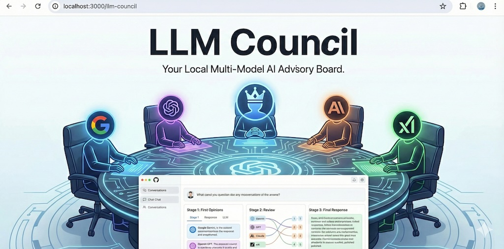

# NTU LLM Council



## Overview

This repository contains a multi-LLM Council framework developed for research into **single-cell annotation using gene-expression marker profiles**. The project investigates how different retrieval-augmented generation (RAG) orchestration strategies influence annotation accuracy and the performance of collaborative LLM systems.

Rather than relying on a single language model, the Council combines predictions from multiple models and uses a designated Chairman model to synthesize their outputs into a final annotation. The framework is designed to support controlled comparisons between different approaches to model collaboration and biological knowledge retrieval.

## Research Framework

The project evaluates several experimental configurations:

1. **Original LLM Council (RAG-less):** Council members independently annotate a cell from its marker-gene profile. The Chairman then synthesizes their predictions into a final answer without retrieval-augmented evidence.
2. **Base-Centric RAG Council:** Council members receive retrieved biological reference information alongside the input profile before generating their predictions. The Chairman synthesizes their outputs.
3. **Chairman-Centric RAG Council:** The Chairman performs retrieval and provides the resulting evidence to support the Council's annotation process.
4. **Single-Model Baseline:** MedGemma 4B performs annotation independently, providing a baseline for evaluating the contribution of the multi-model Council.

The project also examines prediction agreement and annotation accuracy against reference labels. Additional evaluation may consider different annotation categories, including cell identity, extended cell identity, and tissue.

## Architecture

The framework consists of several core components:

- **Model routing:** Dispatches inference requests to the configured local models and their respective backends.
- **Council inference:** Collects independent predictions from the participating models.
- **RAG pipeline:** Retrieves relevant biological reference information and incorporates it into prompts according to the experimental strategy.
- **Chairman synthesis:** Evaluates the Council's outputs and produces the final annotation.
- **Evaluation pipeline:** Compares predictions against reference annotations and calculates accuracy, agreement, and other experimental metrics.

The implementation uses local model inference to support reproducible experimentation and reduce dependence on external model APIs.

## Setup

### 1. Install Dependencies

Install the project's Python dependencies using `uv`:

```bash
uv sync
```

Install the frontend dependencies if you intend to run the web interface:

```bash
cd frontend
npm install
cd ..
```

### 2. Configure Models

Review `backend/config.py` to inspect or modify the configured models, model backends, and routing settings.

The project uses a combination of local model backends, including Ollama and Hugging Face-based inference where configured. Model availability and memory requirements depend on the selected configuration.

Ensure the required models are installed and accessible before running inference.

### 3. Configure Environment Variables

If a particular component requires API credentials or other environment variables, configure them locally in a `.env` file according to that component's requirements. Do not commit API keys, credentials, or other secrets to the repository.

## Running the Application

If the web interface is configured for the current version of the project, start it using:

```bash
./start.sh
```

Alternatively, run the backend and frontend separately.

**Backend:**

```bash
uv run python -m backend.main
```

**Frontend:**

```bash
cd frontend
npm run dev
```

Then open the local address displayed by the frontend development server.

For research experiments, use the relevant annotation and evaluation scripts provided in the repository. Check their configuration for the required input files, marker-gene columns, output paths, and model settings before execution.

## Tech Stack

- **Language:** Python
- **Backend:** FastAPI and asynchronous inference
- **Frontend:** React and Vite, where applicable
- **Model inference:** Local model backends, including Ollama and Hugging Face where configured
- **Retrieval-augmented generation:** Biological reference retrieval and prompt construction
- **Data processing:** Pandas and CSV-based experimental datasets
- **Package management:** `uv` for Python and `npm` for JavaScript

## Research Context

This repository supports an ongoing research project examining multi-model collaboration and retrieval orchestration for single-cell annotation. Experimental results should be interpreted in light of the dataset, reference-label definitions, model configurations, and evaluation methodology used for each run.

The repository is intended to support further development, experimentation, and reproducibility of the research pipeline.
